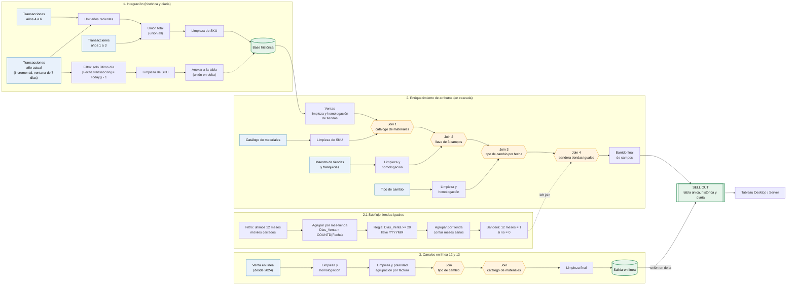
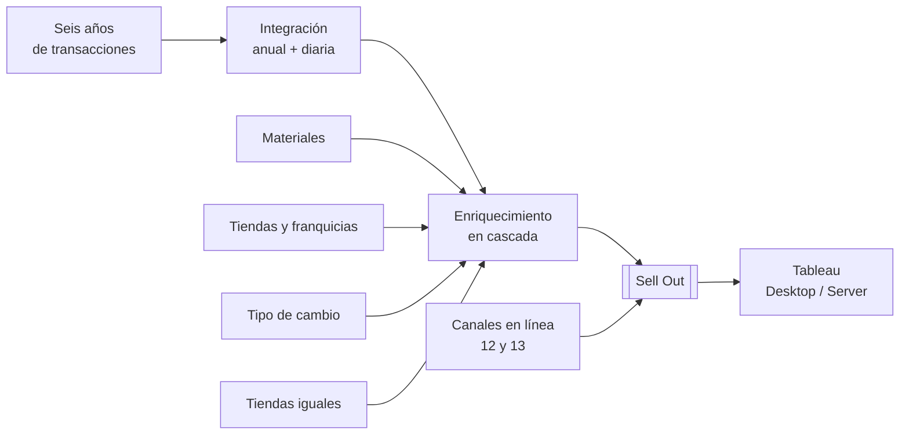

# Reingeniería del flujo de transacciones de venta (Sell Out)

-2E8B57)

Rediseño completo de un proceso de preparación de datos de transacciones de venta, construido con **Tableau Prep**. Pasó de consultas masivas y recargas completas a un conjunto de **flujos modulares** con **carga incremental** y **enriquecimiento en cascada**.

> **Nota:** los nombres de fuentes, tablas, campos y países son genéricos. No incluye datos reales ni credenciales.

## Contenido

1. [Resumen](#1-resumen)
2. [Situación inicial](#2-situación-inicial)
3. [Problemas detectados](#3-problemas-detectados)
4. [Objetivos](#4-objetivos)
5. [Alcance](#5-alcance)
6. [Arquitectura de la solución](#6-arquitectura-de-la-solución)
7. [Detalle de cada flujo](#7-detalle-de-cada-flujo)
8. [Reglas de negocio implementadas](#8-reglas-de-negocio-implementadas)
9. [Antes y después](#9-antes-y-después)
10. [Mejoras clave](#10-mejoras-clave)
11. [Logros y avances](#11-logros-y-avances)
12. [Decisiones de diseño](#12-decisiones-de-diseño)
13. [Riesgos y limitaciones](#13-riesgos-y-limitaciones)
14. [Próximos pasos](#14-próximos-pasos)
15. [Conocimientos que demuestra](#15-conocimientos-que-demuestra)
16. [Glosario](#16-glosario)

---

## 1. Resumen

| Concepto | Descripción |
|---|---|
| **Qué es** | Pipeline de datos que consolida, limpia y enriquece las transacciones de venta (físicas y en línea) en una sola salida llamada **Sell Out**. |
| **Herramienta** | Tableau Prep (flujos programables en servidor). |
| **Fuentes** | Transacciones de venta de seis años, ventas en línea (canales 12 y 13) y cuatro catálogos: materiales, tiendas y franquicias, tipo de cambio y tiendas iguales. |
| **Salida** | Tabla única, histórica y actualizada diariamente, lista para consumo en Tableau Desktop y Server. |
| **Idea central** | Procesar solo lo nuevo cada día y recalcular los atributos del histórico contra catálogos vigentes. |

## 2. Situación inicial

El proceso original se apoyaba en consultas grandes contra el sistema transaccional (BW/HANA) que traían la información completa en cada actualización. Los atributos descriptivos (familia, estatus, tienda) venían en la propia venta, tal como estaban cuando se registró la transacción.

## 3. Problemas detectados

- **Carga excesiva sobre la fuente:** cada actualización consultaba grandes volúmenes en el sistema transaccional y comprometía su disponibilidad.
- **Reprocesamiento innecesario:** se volvía a procesar toda la historia aunque solo cambiara el último día.
- **Atributos desactualizados:** si un producto cambiaba de familia, el histórico conservaba la familia anterior y los análisis no eran comparables en el tiempo.
- **Venta física y digital separadas:** cada una tenía su propia preparación, con atributos que no siempre coincidían.
- **Llaves de cruce inconsistentes:** el SKU llegaba con ceros a la izquierda en unas fuentes y sin ellos en otras, lo que generaba registros huérfanos al cruzar.
- **Riesgo de nulos en monedas:** había países cuya operación rompía el cruce con tipos de cambio.
- **Indicador de tiendas comparables frágil:** un cambio de franquiciatario, cliente SAP o mandante alteraba el resultado.

## 4. Objetivos

**Objetivo general:** construir una arquitectura de datos eficiente, mantenible y consistente para el análisis de Sell Out.

**Objetivos específicos**

1. **Proteger la fuente transaccional:** extraer solo el incremento nuevo y hacer el procesamiento pesado fuera de ella.
2. **Mantener los atributos actualizados:** que un cambio en un catálogo se refleje en todo el histórico sin intervención manual.
3. **Gobernar el dato único:** que la venta física y la digital pasen por los mismos catálogos y no haya discrepancias.
4. **Estandarizar llaves:** una sola regla de limpieza del SKU en todos los flujos.
5. **Dar soporte multimoneda y multimercado:** sin nulos ni cruces rotos.
6. **Calcular tiendas iguales de forma robusta:** que no dependa de cambios de franquiciatario.
7. **Entregar una salida lista para consumo:** sin transformaciones adicionales en el dashboard.

## 5. Alcance

- **Incluye:** integración histórica de seis años, carga diaria incremental, enriquecimiento con catálogos, indicador de tiendas iguales, flujo de canales en línea y salida única.
- **No incluye:** los dashboards que consumen la salida, la administración del servidor ni cambios en el sistema transaccional de origen.

## 6. Arquitectura de la solución

La solución se compone de **cuatro flujos** que convergen en una sola salida (**Sell Out**):

1. **Integración anual / diaria** (carga histórica + incremental)
2. **Enriquecimiento de atributos** (joins en cascada)
   - 2.1 **Subflujo de tiendas iguales**
3. **Flujo de canales en línea 12 y 13**

### Diagrama general

### Vista simplificada

## 7. Detalle de cada flujo

### 7.1 Integración anual (carga histórica)

**Propósito:** consolidar seis años de transacciones de venta, estandarizar el identificador de producto y generar una base unificada.

| Elemento | Detalle |
|---|---|
| **Entradas** | Seis fuentes anuales. Las primeras tres forman el bloque histórico y las otras tres el bloque reciente. |
| **Proceso** | 1) Se unen los años recientes. 2) Se unen con el bloque histórico (*union all*). 3) Se aplica la limpieza del SKU. |
| **Regla clave** | Se eliminan los ceros a la izquierda del SKU (por ejemplo, `000456` pasa a `456`) para dejar una llave de cruce estándar. |
| **Salida** | Base histórica completa, limpia y lista para los flujos posteriores. |
| **Frecuencia** | Solo cuando se requiere una actualización histórica. |
| **Tiempo** | Una recarga histórica completa toma unos 30 minutos. |

La fuente del año actual está configurada como **carga incremental**, con una ventana de recarga hacia atrás (7 días) a partir de la fecha de transacción. Eso reduce de forma importante la demanda de recursos sobre la fuente.

### 7.2 Integración diaria (carga incremental)

**Propósito:** procesar únicamente los datos más recientes y sumarlos a la base histórica.

| Etapa | Qué hace |
|---|---|
| **Extracción focalizada** | Filtra la fuente del año actual con `[Fecha transacción] = Today() - 1`. |
| **Estandarización** | Aplica la misma limpieza de SKU, para que la llave sea idéntica a la de la base consolidada. |
| **Carga incremental** | Escribe con la opción *anexar a la tabla*, que inyecta los registros nuevos sin tocar el histórico. |

> La arquitectura delta es la clave de la eficiencia operativa: no se reprocesan seis años de historia cada día.

### 7.3 Enriquecimiento de atributos

**Propósito:** tomar la base transaccional consolidada y enriquecerla con cuatro cruces en cascada. Cada fase agrega una capa de contexto a la venta.

**Fase 1: preparación de hechos y dimensión base**
- **Ventas:** se estandarizan los nombres de las tiendas y se aplica la limpieza del SKU para preparar la llave primaria.
- **Catálogo de materiales:** se extrae el maestro de materiales y se le aplica la misma limpieza de SKU para que el cruce sea exacto.

**Fase 2: enriquecimiento de materiales**
- Join de ventas con materiales a nivel SKU.
- **Regla de negocio:** se eliminan los atributos descriptivos "sucios" que venían en la venta original y se conserva únicamente la taxonomía oficial del catálogo.
- **Depuración:** se eliminan las llaves duplicadas generadas por el join y se ajustan los nombres de columnas.

**Fase 3: enriquecimiento de clientes y franquicias**
- Join con el maestro de tiendas usando una **llave compuesta de tres campos** (mandante, cliente SAP, país y tienda).
- Se crean campos calculados para asegurar la consistencia del análisis.
- **Depuración:** se podan los campos redundantes de la dimensión para no arrastrar basura al resultado.

**Fase 4: conversión de moneda**
- Join con la tabla de tipos de cambio mediante campos de fecha, para tener el tipo de cambio histórico correcto.
- Se aplicó un tratamiento con **datos de relleno (dummy)** para que las operaciones de un país específico no se rompan ni generen nulos en el modelo.

**Fase 5: clasificación de tiendas y cierre**
- *Left join* con la bandera de tiendas iguales.
- **Barrido final:** control de calidad que elimina cualquier campo llave repetido que haya sobrevivido a los cruces y renombra columnas para entregar una estructura limpia.
- **Salida:** extracto final con toda la historia transaccional actualizada con los catálogos vigentes.

### 7.4 Subflujo de tiendas iguales

**Propósito:** calcular un indicador de tiendas comparables que no se vea afectado por un cambio de franquiciatario, cliente SAP o mandante.

| # | Etapa | Qué hace |
|---|---|---|
| 1 | **Filtro inicial** | Limita el universo a los últimos 12 meses móviles cerrados, para no procesar los seis años. Define la ventana de evaluación. |
| 2 | **Granularidad mes-tienda** | Sube el detalle de día a mes. Calcula `Dias_Venta = COUNTD(Fecha)` para medir la salud operativa de la tienda en ese mes. |
| 3 | **Regla de negocio** | Aplica el umbral `IF Dias_Venta >= 20`. Un mes con menos días se descarta, porque la tienda estuvo cerrada más de 10 días (remodelación, falla técnica o apertura a fin de mes). Si pasa, se genera una llave temporal `YYYYMM`. |
| 4 | **Consolidación por tienda** | Vuelve a agrupar, ya sin el tiempo, y cuenta cuántos "meses sanos" acumuló cada tienda en la ventana. |
| 5 | **Bandera final** | Si la tienda tiene 12 meses con al menos 20 días de venta, recibe el valor `1` (tienda igual). Si no, `0`. |
| 6 | **Integración** | La bandera binaria se inyecta al flujo principal con un *left join*. |

### 7.5 Flujo de canales en línea (12 y 13)

**Propósito:** procesar las ventas digitales con la misma lógica de enriquecimiento que las tiendas físicas.

| Paso | Qué hace |
|---|---|
| **1. Extracción y tratamiento base** | Se ingresa la venta en línea, con datos desde 2024. Se eliminan campos y se trata la polaridad de documentos. |
| **2. Compresión de granularidad** | Se agrupa por factura. Consolida transacciones y elimina duplicados que a veces inyectan los conectores de e-commerce. |
| **3. Conversión de moneda** | Cruce con la tabla de tipo de cambio histórico. |
| **4. Homologación de catálogo** | Cruce con el catálogo maestro de materiales (previamente limpiado), de modo que el dashboard use la taxonomía oficial sin importar el sistema de origen. |
| **5. Cierre** | Estructuración final de columnas, renombrado y generación del extracto. Se une en delta a la salida del flujo de enriquecimiento. |

## 8. Reglas de negocio implementadas

| Regla | Dónde se aplica | Por qué existe |
|---|---|---|
| Quitar ceros a la izquierda del SKU | Todos los flujos | Garantiza que las llaves de cruce coincidan y no haya registros huérfanos. |
| Conservar solo la taxonomía del catálogo | Cruce con materiales | Elimina atributos descriptivos "sucios" de la venta original. |
| Llave compuesta de tres campos | Cruce con tiendas | Identifica una tienda de forma única entre mandantes y países. |
| Tipo de cambio por fecha | Cruce con tipo de cambio | Usa la tasa histórica correcta, no la vigente. |
| Datos de relleno para un país | Cruce con tipo de cambio | Evita nulos y cruces rotos. |
| Mes válido con 20 o más días de venta | Tiendas iguales | Descarta meses atípicos por cierres. |
| Tienda igual con 12 meses válidos | Tiendas iguales | Define la comparabilidad de la tienda. |
| Agrupar por factura | Canales en línea | Elimina duplicados de conectores de e-commerce. |

## 9. Antes y después

| Aspecto | Antes | Después |
|---|---|---|
| **Extracción** | Consultas masivas y completas a la fuente transaccional. | Incremental: solo el día nuevo. |
| **Procesamiento** | Se repetía sobre toda la historia. | El procesamiento pesado ocurre fuera de la fuente. |
| **Atributos** | Congelados al momento de la venta. | Se recalculan contra catálogos vigentes en cada ejecución. |
| **Llave SKU** | Formatos distintos según la fuente. | Una sola regla de limpieza en todos los flujos. |
| **Venta física y digital** | Preparaciones separadas y atributos distintos. | Mismos catálogos y una salida unificada. |
| **Monedas** | Riesgo de nulos por país. | Cruce por fecha con tratamiento de relleno. |
| **Tiendas iguales** | Sensible a cambios de franquiciatario. | Regla basada en días de venta por mes, independiente del franquiciatario. |
| **Actualización histórica** | Proceso largo y manual. | Unos 30 minutos para una recarga completa. |
| **Mantenimiento** | Un proceso grande y difícil de depurar. | Flujos modulares con una responsabilidad cada uno. |

## 10. Mejoras clave

- **Carga delta en lugar de recarga completa:** reduce el tiempo de ejecución y el consumo de recursos del servidor.
- **Protección de la fuente:** el sistema transaccional deja de recibir consultas masivas.
- **Histórico que se corrige solo:** si un producto cambia de familia hoy, sus seis años de historia se actualizan automáticamente.
- **Estandarización de llaves:** la misma limpieza de SKU en todos los flujos evita registros huérfanos.
- **Control de calidad integrado:** un paso de depuración al final de cada fase de cruce evita campos duplicados y llaves residuales.
- **Un solo camino de datos para venta física y digital:** elimina discrepancias en los atributos.
- **Preparación para otros tratamientos de moneda:** facilita aplicar tipo de cambio a mes cerrado, diario o de fecha específica.

## 11. Logros y avances

- [x] Seis años de historia transaccional unificados en una sola base.
- [x] Carga diaria incremental operando, con anexión a la tabla histórica.
- [x] Enriquecimiento en cascada con cuatro cruces documentados y su depuración.
- [x] Indicador de tiendas iguales automatizado, con regla de viabilidad por mes.
- [x] Flujo de canales en línea integrado a la misma salida.
- [x] Gobernanza de dato único: venta física y digital pasan por los mismos catálogos.
- [x] Documentación técnica de cada flujo, con sus reglas y decisiones.
- [x] Recarga histórica completa en unos 30 minutos.

## 12. Decisiones de diseño

| Decisión | Alternativa descartada | Razón |
|---|---|---|
| Flujos separados por responsabilidad (integración, enriquecimiento, tiendas iguales, canales en línea) | Un solo flujo grande | Facilita el mantenimiento, la depuración y la incorporación de nuevas fuentes. |
| Carga incremental con anexión | Recarga completa diaria | Evita reprocesar años de historia. |
| Catálogo vigente como única fuente de atributos | Atributos de la venta original | Mantiene el histórico comparable en el tiempo. |
| Limpieza de SKU antes de cualquier cruce | Limpiar después del join | Evita registros huérfanos desde el origen. |
| Depuración al final de cada cruce | Un solo barrido final | Evita arrastrar campos redundantes entre fases. |
| Umbral de 20 días de venta por mes | Contar cualquier mes con venta | Descarta meses con cierres operativos. |

## 13. Riesgos y limitaciones

- **Dependencia de los catálogos:** un error en un catálogo se propaga a todo el histórico en la siguiente ejecución.
- **Ventana incremental:** si falla una corrida diaria, el día faltante debe recuperarse con la ventana de recarga o con una carga manual.
- **Cargas por anexión:** si un flujo se ejecuta dos veces el mismo día, pueden duplicarse registros, así que conviene validar antes de reejecutar.
- **Dependencia del servidor:** el procesamiento ocurre en Tableau Server, así que su disponibilidad y capacidad afectan el tiempo de ejecución.
- **Datos de relleno en un país:** resuelven los nulos, pero deben revisarse si cambia la operación de ese país.
- **Canales en línea desde 2024:** el historial digital es más corto que el físico.

## 14. Próximos pasos

- [ ] Tratamientos alternativos de tipo de cambio: a mes cerrado, diario y de fecha específica.
- [ ] Validaciones automáticas de conteos y de nulos en la llave SKU después de cada ejecución.
- [ ] Reconciliación periódica contra la fuente transaccional.
- [ ] Alertas cuando falle una corrida diaria.
- [ ] Incorporar nuevas fuentes digitales sin modificar el resto del pipeline.

## 15. Conocimientos que demuestra

- Diseño de pipelines por etapas (integración, enriquecimiento y salida).
- Carga incremental frente a recarga completa.
- Limpieza y estandarización de llaves de cruce.
- Modelado dimensional: hechos y dimensiones con joins en cascada.
- Indicadores comparables (tiendas iguales) con reglas de negocio.
- Manejo de monedas, valores nulos y duplicados.
- Gobernanza de dato único entre canales.
- Documentación técnica de flujos de datos.

## 16. Glosario

| Término | Significado |
|---|---|
| **Transacción de venta** | Registro de una venta realizada en tienda o en línea. |
| **Sell Out** | Venta del distribuidor o tienda al cliente final. |
| **SKU** | Identificador único de producto. |
| **Carga incremental / delta** | Procesar solo los datos nuevos y sumarlos a lo existente. |
| **Tienda igual** | Tienda con operación comparable durante el periodo de evaluación. |
| **Polaridad** | Signo de un documento (venta o devolución) al sumar importes. |
| **Join / left join** | Cruce de tablas por una o varias llaves. |
| **Dimensión** | Catálogo descriptivo (productos, tiendas, monedas). |
| **Mandante** | Instancia o cliente lógico dentro del sistema SAP. |
